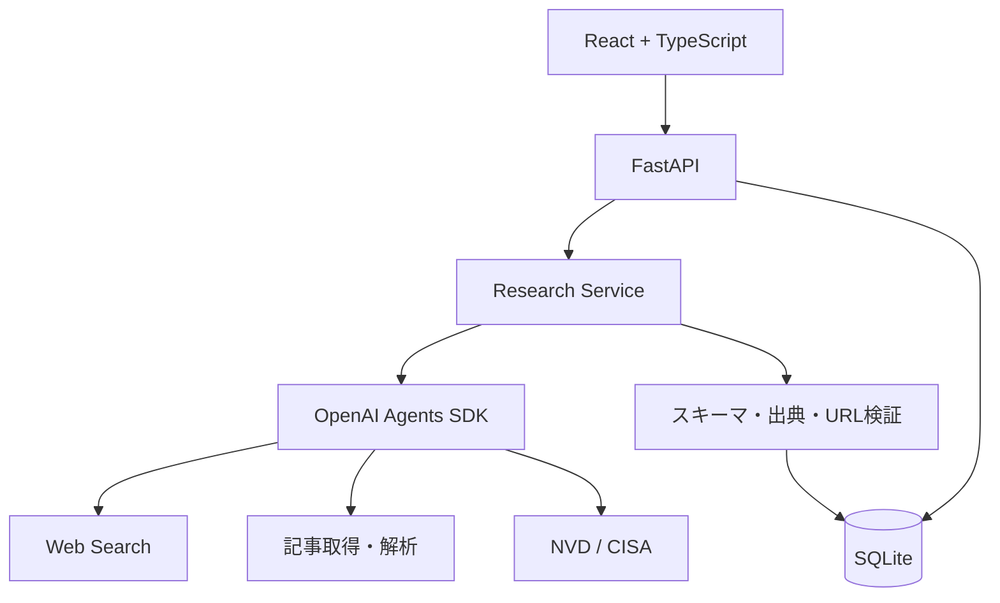

# AI技術・セキュリティニュース調査エージェント — MVP開発設計

作成日：2026-11-06

プロジェクト名（仮）：`ai-news-agent`

目標：12月上旬のAIエージェント・AIアプリ開発ポジションの面接までに、動作するデモと設計判断の説明を用意する。

## 1. プロダクト概要

AI技術・サイバーセキュリティのニュースを調査し、一次情報を優先して日本語で整理・保存するWebアプリケーション。

### 主な利用シナリオ

- 「直近7日間のAIエージェント関連ニュースを5件調査して」
- 「このCVEの影響製品と修正版を教えて」
- 過去に保存したニュースを一覧・キーワード検索する。

### 開発方針

1. Python CLIでニュース調査エージェントを実装する。
2. FastAPIとSQLiteでAPI・保存機能を追加する。
3. React + TypeScriptでWebアプリ化する。
4. 評価・セキュリティ対策を加え、面接用のデモに仕上げる。

## 2. MVP要件定義

### 2.1 機能要件

| ID | 機能 | 優先度 |
| --- | --- | --- |
| F01 | AI・セキュリティニュースの検索 | 必須 |
| F02 | タイトル・URL・公開日の取得 | 必須 |
| F03 | 日本語要約・カテゴリ分類 | 必須 |
| F04 | 公式情報との照合・出典表示 | 必須 |
| F05 | DB保存・重複排除 | 必須 |
| F06 | 過去ニュースの一覧・キーワード検索 | 必須 |
| F07 | CVE番号から脆弱性情報を取得 | 必須 |
| F08 | 自然言語による深掘り質問 | 次段階 |
| F09 | RAGによる意味検索 | 次段階 |
| F10 | 定期実行・通知 | 次段階 |

### 2.2 非機能要件

| 項目 | MVPの方針 |
| --- | --- |
| 信頼性 | 出典不明の記事を確定情報として扱わない。公開日・根拠を検証する |
| セキュリティ | APIキーはサーバー側の環境変数で管理。URL検証とSSRF対策を行う |
| 冪等性 | 同一記事を再取得しても重複登録しない |
| 可観測性 | ツール呼び出し、処理時間、失敗、API使用量を記録 |
| 品質 | 代表的な20ケースの評価データを作成 |
| コスト | 調査単位で使用量と概算コストを把握する |

## 3. 技術スタック

| レイヤー | 採用技術 | 目的 |
| --- | --- | --- |
| 言語 | Python 3.12+ | エージェント・API実装 |
| LLM | OpenAI API | 調査判断・要約・分類 |
| エージェント | OpenAI Agents SDK | Tool Calling・実行制御 |
| 検索 | OpenAI Web Search | 最新ニュースの調査 |
| セキュリティ情報 | NVD API / CISA KEV | CVE・悪用情報の照合 |
| API | FastAPI + Pydantic | REST API・入力検証 |
| DB | SQLite + SQLAlchemy | 記事・実行履歴の永続化 |
| フロント | React + TypeScript + Vite | 調査UI・ニュース一覧 |
| テスト | pytest / pytest-asyncio / Ruff | 自動テスト・静的検査 |
| 後続候補 | pgvector / Chroma / Langfuse | RAG・監視・評価 |

最初からマルチエージェント化せず、単一エージェントと複数ツールで開始する。

## 4. システムアーキテクチャ



### 責務分離

- **Agent**：調査対象の解釈、ツール選択、追加調査の判断、結果統合。
- **Tools**：検索、記事取得、CVE情報取得など外部情報へのアクセス。
- **Services**：検証、重複排除、保存、調査の状態管理。
- **DB**：記事・出典・実行履歴の管理。
- **API**：HTTPインターフェースと入力検証。

LLMにDB書き込みを直接委ねず、検証済みの構造化データをサービス層で保存する。OpenAIの組み込みWeb Searchと独自のPython関数ツールは区別し、必要に応じて段階的に導入する。

## 5. ディレクトリ構成

```text
ai-news-agent/
├── backend/
│   ├── pyproject.toml
│   ├── .env.example
│   ├── src/
│   │   └── ai_news_agent/
│   │       ├── main.py
│   │       ├── config.py
│   │       ├── api/
│   │       │   ├── routes_news.py
│   │       │   └── routes_research.py
│   │       ├── agents/
│   │       │   ├── researcher.py
│   │       │   ├── prompts.py
│   │       │   └── schemas.py
│   │       ├── tools/
│   │       │   ├── search.py
│   │       │   ├── articles.py
│   │       │   └── cve.py
│   │       ├── services/
│   │       │   ├── research.py
│   │       │   └── news.py
│   │       └── db/
│   │           ├── models.py
│   │           └── repository.py
│   └── tests/
│       ├── test_tools.py
│       ├── test_research.py
│       └── test_api.py
├── frontend/
│   ├── package.json
│   └── src/
│       ├── App.tsx
│       ├── components/
│       ├── pages/
│       └── api/
├── evals/
│   ├── datasets/
│   │   └── research_cases.jsonl
│   └── evaluate.py
├── docs/
│   ├── requirements.md
│   ├── architecture.md
│   ├── decisions/
│   └── plans/
├── .github/
│   └── workflows/
│       └── ci.yml
├── .gitignore
└── README.md
```

## 6. ツール設計

| ツール | 入力 | 出力 | 役割 |
| --- | --- | --- | --- |
| `search_news` | クエリ・対象期間 | 候補記事・出典 | ニュース検索（独自ツールを採用する段階で実装） |
| `fetch_article` | URL | 本文・メタデータ | 記事の取得・解析 |
| `get_cve_details` | CVE ID | 深刻度・影響製品・参照URL | 脆弱性情報の照合 |
| `save_news` | 検証済み記事 | 保存結果 | サービス層からのDB保存。LLMに直接公開しない |

### エージェントの出力スキーマ（例）

```json
{
  "query": "直近7日間のAIエージェントニュース",
  "articles": [
    {
      "title": "記事タイトル",
      "url": "https://example.com/article",
      "published_at": "2026-11-06",
      "category": "AI技術",
      "summary": "日本語での要約",
      "source_urls": ["https://example.com/article"],
      "verification_status": "verified"
    }
  ]
}
```

上記URLと記事はスキーマ説明用のダミー。`verification_status` は一次情報で確認済みかどうかを示し、未確認なら `unverified` とする。検索結果の記述だけで検証済みとは判定しない。

## 7. データモデル

### `articles`

`id`, `title`, `url`（UNIQUE）, `published_at`, `source`, `category`, `summary`, `created_at`

### `research_runs`

`id`, `query`, `status`, `started_at`, `finished_at`, `error`

### `research_sources`

`id`, `run_id`, `article_id`, `source_url`, `verified_at`

保存前にURLを正規化し、重複排除を実施する。記事と調査実行は別概念として扱う。

## 8. REST API設計

| Method | Endpoint | 用途 |
| --- | --- | --- |
| POST | `/api/research` | 調査開始、実行IDを返却 |
| GET | `/api/research/{id}` | 調査結果・実行状態の確認 |
| GET | `/api/news` | ニュース一覧 |
| GET | `/api/news/{id}` | 記事詳細 |
| GET | `/api/news?query=...` | キーワード検索 |
| GET | `/api/health` | ヘルスチェック |

調査は長時間になる場合があるため、開始APIと状態取得APIを分離する。MVPのプロセス内バックグラウンド実行は再起動でジョブが失われる可能性があるため、本番運用では永続キューを検討する。

## 9. 実装手順と完了条件

### Step 1：環境構築

```bash
mkdir ai-news-agent && cd ai-news-agent
mkdir backend frontend docs evals
cd backend
uv init --package
uv add openai-agents fastapi "uvicorn[standard]" pydantic-settings httpx sqlalchemy
uv add --dev pytest pytest-asyncio ruff
```

- [x] Pythonプロジェクト作成
- [x] `.env.example` 作成（秘密情報は含めない）
- [x] `/api/health` を実装
- [x] pytest・Ruffを実行できる

**完了条件**：ヘルスチェックがHTTP 200を返す。

2026-11-06確認済み：Uvicornを起動して`GET /api/health`がHTTP 200と`{"status":"ok"}`を返却。pytest 1件成功、Ruffのチェック・フォーマット確認成功。

### Step 2：検索・CVE取得

- [ ] OpenAI Web Searchによる検索を試す
- [ ] NVD APIのレスポンスをPydanticで検証
- [ ] URL・公開日・情報源を抽出
- [ ] タイムアウト、HTTPエラー、レート制限を処理
- [ ] 外部APIをモックしたテストを追加

**完了条件**：ニュース検索とCVE取得を個別に検証できる。

### Step 3：調査エージェント

- [ ] 単一エージェントを構築
- [ ] 検索とCVE取得を適切に呼び分ける
- [ ] 結果を構造化スキーマへ変換
- [ ] 出典URL・公開日・未確認情報を明示
- [ ] 失敗時の終了条件を定義

**完了条件**：指定期間のニュースを最大5件調査し、根拠付きでJSON出力できる。

### Step 4：DB・REST API

- [ ] SQLiteテーブル作成
- [ ] URL正規化と重複排除
- [ ] 調査実行履歴の保存
- [ ] ニュース一覧・詳細API
- [ ] APIの正常系・異常系テスト

**完了条件**：同一記事の再登録で重複せず、APIから記事を取得できる。

### Step 5：React画面

- [ ] React + TypeScript + Viteのセットアップ
- [ ] 調査入力フォーム
- [ ] 調査状態の表示
- [ ] ニュース一覧とカテゴリフィルタ
- [ ] 記事詳細・出典リンク

**完了条件**：ブラウザから調査を開始し、結果を閲覧できる。

### Step 6：評価・セキュリティ

- [ ] 20件の評価ケースを作成
- [ ] 出典URL・公開日・要約の忠実性を評価
- [ ] プロンプトインジェクション耐性を確認
- [ ] SSRF、APIキー漏えい、過大入力への対策
- [ ] 処理時間・トークン使用量・概算コストを計測
- [ ] READMEに失敗事例と改善内容を記載

**完了条件**：評価結果と設計上のトレードオフを説明できる。

## 10. 開発スケジュール

| 期間 | 主題 | 成果物 |
| --- | --- | --- |
| 11/6〜11/12 | Tool Calling・検索 | CLIでニュースを調査できる |
| 11/13〜11/19 | DB・API・過去記事検索 | SQLite保存・REST API |
| 11/20〜11/26 | セキュリティ・評価 | テスト・評価データセット |
| 11/27〜12/3 | Webアプリ・面接準備 | Reactデモ・README・設計説明 |

RAGによる意味検索は余裕があれば追加する。MVPでは通常のキーワード検索を優先する。

## 11. 面接で説明する設計判断

| テーマ | 説明すべき論点 |
| --- | --- |
| Tool Calling | LLMの判断と決定的な処理をどう分離したか |
| RAG | キーワード検索とベクトル検索の使い分け |
| セキュリティ | 外部記事を信頼しない設計、SSRF、秘密情報管理 |
| 評価 | 検索品質・出典正確性・要約忠実性の測定 |
| 運用 | リトライ・レート制限・コスト・レイテンシ |
| エージェント設計 | 単一エージェントを採用する理由、マルチエージェント化の判断基準 |

## 12. 最初の実装課題

> 直近7日間のAIエージェント技術ニュースを5件調査し、タイトル・要約・公開日・出典URLをJSONで返す。

### 受け入れ条件

- [ ] 実在する記事を取得できる
- [ ] 公開日が指定期間内であることを確認できる
- [ ] 出典URLが検証可能である
- [ ] 取得不能・未確認情報を明示できる
- [ ] 検索失敗時も適切に終了する
- [ ] 同じ入力での評価結果を記録できる

## 13. MVP完成後の拡張候補

1. RAGによる過去ニュースの意味検索
2. 定期実行（GitHub Actions / Cloud Scheduler）
3. メール・Slack等への通知
4. ユーザーの関心テーマに基づく重要度評価
5. マルチエージェントによる検索・検証・要約の役割分担

## 14. 参考資料

- [OpenAI Agents SDK](https://openai.github.io/openai-agents-python/)
- [OpenAI APIドキュメント](https://platform.openai.com/docs/)
- [NVD Developer API](https://nvd.nist.gov/developers/vulnerabilities)
- [CISA Known Exploited Vulnerabilities Catalog](https://www.cisa.gov/known-exploited-vulnerabilities-catalog)
- [FastAPI](https://fastapi.tiangolo.com/)

---

**設計原則**：LLMは曖昧な調査要求の解釈、追加調査の判断、複数情報源の統合に利用する。URL検証、重複排除、DB保存などの決定的処理は通常のPythonコードで担保する。
